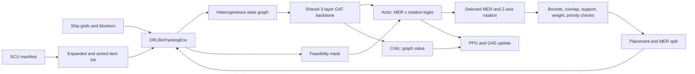

# Current Architecture

This document describes the implementation in the current repository, not an
idealized version of the design. Where the code contains an incomplete
experiment or a known mismatch, that behavior is called out explicitly.

## System at a glance

The learned policy does not place arbitrary boxes at arbitrary coordinates.
It chooses among candidates maintained by a maximal-empty-region (MER)
geometry engine. The environment applies the hard constraints, updates the
geometry, and exposes the next state as a graph.



The main execution paths are:

- Training: `src/train_ensemble.py` -> `packing_core.utils.train_agent`
- Evaluation: `src/evaluate_model.py` -> `pack_single_manifest`
- API inference: `src/api_backend.py` -> `EnsembleRouter` ->
  `pack_single_manifest`
- Backward-compatible universal trainer: `src/gnn_bin_packing_multi.py`

## Cargo and ship inputs

### SCU types

`src/scu_manifest_generator.py` defines seven supported containers:

| Type | Dimensions | Volume | Synthetic weight |
|---|---:|---:|---:|
| 1 SCU | 1 x 1 x 1 | 1 | 10 |
| 2 SCU | 2 x 1 x 1 | 2 | 20 |
| 4 SCU | 2 x 2 x 1 | 4 | 40 |
| 8 SCU | 2 x 2 x 2 | 8 | 80 |
| 16 SCU | 2 x 4 x 2 | 16 | 160 |
| 24 SCU | 2 x 6 x 2 | 24 | 240 |
| 32 SCU | 2 x 8 x 2 | 32 | 320 |

Weights are proportional to SCU and are model units, not commodity-specific
Star Citizen mass values.

### Drop-off-oriented manifest generation

The current generator treats each priority as a delivery stop:

1. Compute a cargo target from usable volume, requested fill ratio,
   difficulty multiplier, and a random +/-3 SCU jitter.
2. Sample one to four drop-offs using category-specific probabilities.
3. Split SCU among those locations with bounded Dirichlet ratios.
4. Fill each location in two phases: weighted bulk containers, then 1/2-SCU
   filler.
5. Assign priority `1..N` in drop-off order.
6. Reject container types that cannot fit any grid under Z-axis rotation.

At `difficulty="hard"`, the difficulty multiplier is 0.9. The evaluator's
requested 0.8 fill ratio therefore targets roughly 0.72 of usable volume
before jitter.

The named Hull-C path uses `bulk-only` manifests during evaluation, removing
1/2-SCU filler to keep the 4,608-SCU case tractable. The training ship pool
currently drops ship names before constructing environments, so this named
exception is not applied by `train_agent`.

### Two category systems

The specialist router and ensemble trainer use:

- small: usable volume <=64
- medium: 65-256
- large: >256

The manifest generator independently uses <=64, 65-512, and >512 to choose
container distributions. These values do not share a configuration constant.
Consequently, a 257-512 SCU ship is routed to the large policy while receiving
the medium manifest distribution. This is current behavior and a candidate
for an explicit design decision or future unification.

### Item ordering

Manifest entries are expanded into individual item tuples. Items of at least
25 SCU are placed first, ordered by descending volume and then priority. All
smaller items are ordered by ascending priority and descending volume. This
hybrid rule reserves room for the largest containers while keeping normal
items compatible with the front-to-back priority constraint.

### Ship geometry and blockers

`ships_cargo_grids.json` stores one or more bounding-box grids per ship.
A grid can include blocker cuboids for ramps, voids, hull intrusions, or other
unusable space. On reset, blockers:

- are validated to be positive, in bounds, and mutually non-overlapping;
- are inserted into the placed-item collection;
- carve their volume out of the initial MER set;
- are excluded from placement results and utilization;
- may optionally have `supports: false`, preventing cargo from resting on
  their upper face.

Specialist routing and reported utilization use bounding volume minus blocker
volume.

## Geometry environment

### Box and MER representation

`Box3D` is float-primary. Coordinates and dimensions are Python floats, while
PyTorch tensor views are created lazily only when a caller asks for them. This
avoids the host/device synchronization and tensor-allocation overhead that
dominated earlier implementations.

Each grid owns a `MERManager`. It starts with one region covering the grid.
After a placement, every overlapping MER can produce up to six children, one
for each side of the placed box. Regions below 1 SCU are discarded. The
current redundancy filter also discards a candidate when another candidate
overlaps more than 90% of its volume; it is an approximation rather than a
strict maximal-space proof.

### Dynamic action space

For `N` MERs across all grids, the environment exposes `2N` actions:

```text
action = 2 * global_mer_index + rotation
rotation 0 = canonical X/Y orientation
rotation 1 = swap X and Y
```

The item height is fixed, so these are the two rotations around Z. The
environment first tries the selected MER origin. If that corner violates a
constraint, it searches integer anchors inside the MER.

Interior search is capped at 32 probes per MER/rotation. This bound prevents
multi-minute worst cases on long cargo lanes, but it also means the mask can
miss a legal placement deeper in a region.

### Hard constraints

Every candidate is checked for:

- containment inside its selected grid;
- non-overlap with cargo and blockers;
- at least 99% support from the floor, supporting blockers, or boxes directly
  below;
- no heavier item resting on a lighter item;
- per-pair stack weight below `max_stack_weight` (100,000 by default);
- front-to-back priority ordering: lower priority numbers must have a Y
  coordinate no greater than later priorities in the same grid.

Priority is a pairwise Y-order rule. It does not model doors, aisles, forklift
clearance, or a complete unloading path.

The environment ends after the manifest is exhausted, when no MER remains, or
at 1,000 steps. API-style inference has an additional 500-step guard.

## Graph state

Every node has 13 scalar features. The first feature is a node-type identifier.
The remaining slots are reused according to node type.

| Node type | One per | Main features |
|---|---|---|
| Ship (`4`) | State | Type only; remaining fields are zero |
| Container/grid (`0`) | Cargo grid | Dimensions, placed count, total item count, fill ratio, MER count, three aspect ratios, relative volume, grid rank |
| Current item (`2`) | State when an item remains | Dimensions, weight, priority |
| Placed item (`1`) | Cargo item or blocker | Dimensions, weight, priority, grid index |
| MER (`3`) | Current empty region | Dimensions, volume, grid index, region/grid volume ratio |

Coordinates are also attached as `data.pos`, but the current GAT passes only
`data.x` and `data.edge_index` into the model. Position therefore affects the
policy indirectly through graph construction and the feasibility mask, not as
a learned coordinate feature.

Bidirectional edges connect:

- ship <-> every grid;
- every grid <-> every other grid;
- a grid <-> its placed items;
- a grid <-> its MERs;
- the current item <-> every grid;
- the current item <-> MERs that pass the dimension-level fit check;
- placed items that share a face within the same grid.

## Neural network

### Shared GAT backbone

Actor and critic are constructed with the same `SharedGNNBackbone` object
during training:

1. `GATConv(13, hidden/4, heads=4)` -> BatchNorm -> ReLU -> dropout
2. `GATConv(hidden, hidden/4, heads=4)` -> BatchNorm -> ReLU -> dropout
3. `GATConv(hidden, hidden, heads=1)` -> BatchNorm -> ReLU -> dropout

The default dropout rate is 0.2. Four attention heads in the first two layers
concatenate back to the configured hidden width.

### Actor

The actor extracts the current-item and MER embeddings. The mean current-item
embedding is projected as a query; MER embeddings are projected as keys.
Scaled dot-product attention produces one scalar weight per MER. Each MER
embedding is then combined with its attention-scaled residual and passed
through a two-output MLP. Flattening produces the two rotation logits per MER.

The CPU boolean feasibility mask is copied to the logits' device and illegal
actions receive `-inf`. Training samples a categorical action. Evaluation and
API inference use `argmax`.

### Critic

The critic mean-pools all graph-node embeddings per graph, then applies a
two-layer value head to produce one scalar state value.

### Parameter counts

| Hidden width | Backbone | Actor total | Critic total | Unique shared actor+critic |
|---:|---:|---:|---:|---:|
| 128 | 36,352 | 86,146 | 52,993 | 102,787 |
| 256 | 138,240 | 336,130 | 204,289 | 402,179 |

Actor and critic totals each include a backbone. The last column counts the
single shared backbone plus both heads as constructed during training.

## Reward

Successful placement reward is assembled as follows:

| Component | Current behavior |
|---|---|
| Volume | `10 * item_volume / selected_grid_usable_volume` |
| Base success | `+2` |
| Boundary contact | `+0.5` per touched grid face |
| Same-priority cluster | up to `+3` before the shared contact cap |
| Bottom support | up to `+2` before the shared contact cap |
| Adjacent item | `+0.5` per touching prior item |
| Neighboring priority | `+0.25` when priority differs by at most one |
| Contact subtotal | capped at `+2` when added to reward |
| Grid balance | 0.75 for two grids, 1.25 for three, 2.0 for four or more, scaled by `1 - std(fill_ratios)` |
| Complete manifest | `min(5 * item_count, 100)` on the final placement |

Invalid or infeasible actions receive -5. No-MER and timeout exits receive
-10. Reward is a training signal; the public evaluation metrics are item
success and usable-volume utilization.

## PPO training

`train_agent` currently runs one complete environment episode at a time:

1. Performance-weighted sampling selects a ship. Multi-grid ships are already
   duplicated two or three times when the ensemble pools are built.
2. A six-stage curriculum chooses difficulty from very-easy through very-hard.
3. The actor is put in evaluation mode for rollout and samples feasible
   actions.
4. Raw rewards update running mean/variance statistics and are normalized.
5. A soft-updated target critic supplies values for GAE.
6. Advantages are normalized.
7. Four shuffled minibatch PPO passes update actor and critic.
8. The target critic receives a soft update.
9. Checkpoint state and training curves are periodically persisted.

| Hyperparameter | Value |
|---|---:|
| Discount `gamma` | 0.95 |
| GAE lambda | 0.95 |
| Actor learning rate | 1e-4 |
| Critic learning rate | 1e-4 |
| PPO clip | 0.2 |
| PPO epochs | 4 |
| Minibatch size | 32 |
| Entropy coefficient | 0.02 |
| Target critic tau | 0.01 |
| Weight decay | 1e-4 |
| Gradient norm cap | 0.5 |

The shared backbone parameters are present in both Adam optimizers. The code
backpropagates a combined actor+critic loss, then steps both optimizers, so the
shared parameters are updated twice with separate optimizer state. This is
important checkpoint-compatible behavior, though a single optimizer with
explicit parameter groups would be easier to reason about.

The `ReplayBuffer` class and `replay_buffer_size` argument remain for
compatibility but are not used by the current on-policy PPO loop.

No-feasible fallback steps contribute to the displayed episode reward but are
not appended to the PPO trajectory. Very short trajectories are recorded but
skip optimization.

### Curriculum schedule

| Fraction of stage | Difficulty |
|---:|---|
| 0-20% | very-easy |
| 20-30% | easy |
| 30-45% | medium-low |
| 45-60% | medium-high |
| 60-80% | hard |
| 80-100% | very-hard |

### Ship sampling

Once a ship has three observations, its sampling weight is
`max(1 - 0.5 * recent_success, 0.3)`. Poorer-performing ships are therefore
sampled more often relative to successful ships. History is held in memory and
is not restored from checkpoints.

### Checkpoint contract

Checkpoints persist:

- actor, critic, and target-critic state dictionaries;
- both optimizers and both learning-rate schedulers;
- completed episode index;
- reward and loss histories;
- running reward mean, variance, and count.

The loaders infer hidden width from the actor score-head weights and use
`strict=False`. Checkpoints are ignored by Git; the default runtime filenames
are `small_gnn_model.pt`, `medium_gnn_model.pt`, and `large_gnn_model.pt` at
the repository root.

## Ensemble inference

`EnsembleRouter` calculates total usable volume and chooses the same <=64,
<=256, or >256 specialist thresholds used by evaluation. If the expected
specialist is unavailable, the router falls back to the first loaded model in
large, medium, small order.

`pack_single_manifest` expands and sorts the supplied manifest, greedily packs
it, and returns:

- placements with SCU type, position, dimensions, priority, grid index/name;
- the actual skipped manifest items;
- item success, usable-volume utilization, and counts;
- optional brute-force diagnostics for MER misses.

## Evaluation contract

`src/evaluate_model.py` is the single general evaluator. It seeds Python,
NumPy, and PyTorch; supports any subset of specialist categories; generates
hard manifests; uses greedy actions; macro-averages per-ship episode means;
and writes `EVALUATION.md`. Optional JSON output uses schema version 1.

The published V6 result predates the seeded unified runner, so its original
seed was not recorded. See [EVALUATION.md](../EVALUATION.md).

## Incomplete and deferred work

- `SyncVectorEnv` is an additive synchronous wrapper. `train_agent` does not
  call it, and its actor/critic "batched" methods still loop over environments.
- `data.pos` is not consumed by the GAT.
- The model-global `device` values are selected at import time, which limits
  explicit mixed-device control.
- Interior-anchor search trades completeness for a 32-probe runtime bound.
- Specialist and manifest category thresholds differ for 257-512 SCU ships.
- Hull-C's named bulk-only rule is applied in evaluation but not the unnamed
  training pool.
- `strict=False` loading can hide missing or unexpected checkpoint keys.
- Evaluation reports point-estimate means without confidence intervals.
